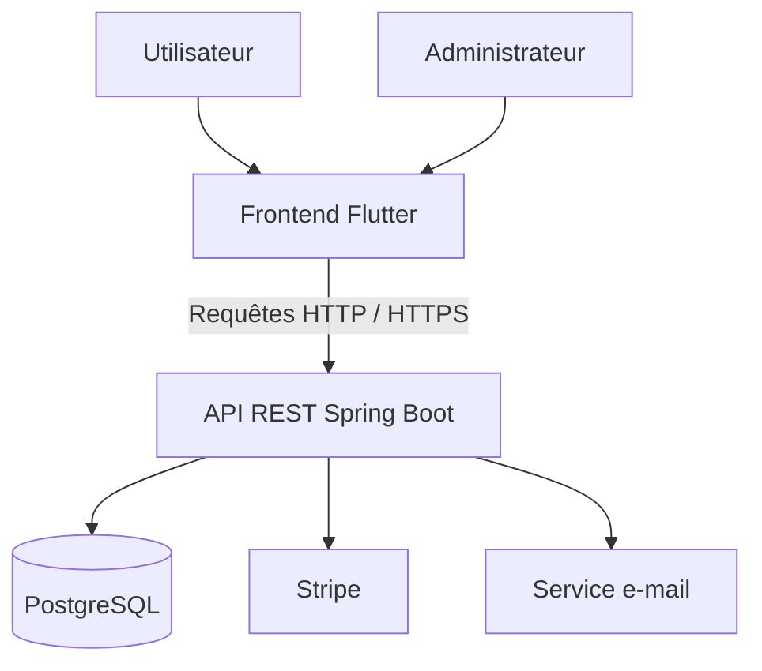

# 🚌 eBus Frontend — Application de transport Flutter

**eBus Frontend** est l’interface utilisateur de la plateforme eBus, une application de gestion du transport développée avec **Flutter et Dart**. Elle permet aux utilisateurs de consulter les informations de transport, de gérer leurs abonnements, d’effectuer des démarches liées aux objets perdus et de soumettre des réclamations.

L’application communique avec un backend **Java / Spring Boot** exposant des API REST et utilisant PostgreSQL pour la persistance des données.

## Technologies utilisées

### Application frontend


### Backend et services intégrés


### Infrastructure


## Sommaire

- [Présentation](#-présentation)
- [Fonctionnalités](#-fonctionnalités)
- [Interfaces de l’application](#-interfaces-de-lapplication)
- [Architecture](#-architecture)
- [Prérequis](#-prérequis)
- [Installation et lancement local](#-installation-et-lancement-local)
- [Configuration de l’API](#-configuration-de-lapi)
- [Compilation Web](#-compilation-web)
- [Exécution Android](#-exécution-android)
- [Docker](#-docker)
- [Tests et qualité logicielle](#-tests-et-qualité-logicielle)
- [Déploiement](#-déploiement)
- [Dépôts associés](#-dépôts-associés)

## 📌 Présentation

Le frontend eBus fournit une interface permettant aux utilisateurs et aux administrateurs d’accéder aux fonctionnalités de la plateforme selon leurs droits.

Développée avec Flutter, l’application vise à proposer une expérience cohérente sur le Web et Android.

Le frontend consomme les API REST du backend Spring Boot pour récupérer les données, transmettre les actions des utilisateurs et afficher les réponses des services métier.

## 🚀 Fonctionnalités

### 👤 Espace utilisateur

- Connexion et accès aux fonctionnalités authentifiées.
- Consultation des informations et des lignes de transport.
- Consultation des offres d’abonnement.
- Accès au parcours de paiement Stripe.
- Déclaration et suivi des objets perdus ou trouvés.
- Création et suivi des réclamations.
- Consultation des informations du compte.

### 🛠️ Espace administrateur

- Accès aux fonctionnalités autorisées pour le rôle administrateur.
- Gestion des lignes de transport et des offres d’abonnement.
- Consultation et traitement des réclamations.
- Gestion des objets perdus ou trouvés.

Les fonctionnalités effectivement disponibles dépendent de la version du frontend et des API exposées par le backend.

## 🖥️ Interfaces de l’application

Ajoute les captures d’écran dans un dossier `docs/screenshots/` à la racine du dépôt.

### 1. Accueil et consultation des lignes


### 2. Authentification


### 3. Espace utilisateur


### 4. Offres et abonnements


### 5. Objets perdus et trouvés


### 6. Réclamations


### 7. Espace administrateur


> **Important :** remplace les noms d’exemple par les noms exacts des captures présentes dans le dépôt. Les images doivent être ajoutées et versionnées pour s’afficher dans le README.

## 🏗️ Architecture



### Rôle du frontend

Le frontend est responsable de :

- l’affichage des interfaces ;
- la navigation entre les écrans ;
- la saisie et la validation des données côté client ;
- l’envoi des requêtes vers les API REST ;
- l’affichage des réponses et des erreurs ;
- l’expérience utilisateur sur le Web et Android.

L’authentification, les autorisations métier et la persistance des données doivent être prises en charge et vérifiées côté backend.

## 📋 Prérequis

Avant de démarrer le projet, installer :

- [Flutter SDK](https://docs.flutter.dev/get-started/install)
- [Dart](https://dart.dev/get-dart) — généralement fourni avec Flutter ;
- Git ;
- Google Chrome pour l’exécution Web ;
- Android Studio et un émulateur, ou un appareil Android, pour les tests mobiles.

Vérifie l’installation :

```powershell
flutter --version
dart --version
flutter doctor
```

## ⚙️ Installation et lancement local

### 1. Cloner le dépôt

```powershell
git clone https://github.com/ikraammel/eBus_frontend.git
cd eBus_frontend
```

### 2. Installer les dépendances

```powershell
flutter pub get
```

### 3. Vérifier le projet

```powershell
flutter analyze
```

### 4. Lancer l’application Web

Si le backend fonctionne sur le port `8080` et si le frontend utilise la variable `API_BASE_URL` :

```powershell
flutter run -d chrome --dart-define=API_BASE_URL=http://localhost:8080
```

Cette commande suppose que le code lit la variable avec `String.fromEnvironment('API_BASE_URL')`. Si le projet utilise une autre variable ou une configuration différente, adapte la commande au code existant.

## 🔌 Configuration de l’API

Le frontend doit cibler l’adresse du backend correspondant à l’environnement testé.

| Environnement | URL indicative |
|---|---|
| Backend exécuté localement | `http://localhost:8080` |
| Backend Docker local | `http://localhost:18081` |
| Backend déployé | `https://ebus-backend-ao2u.onrender.com` |

Pour lancer le frontend contre le backend Docker local :

```powershell
flutter run -d chrome --dart-define=API_BASE_URL=http://localhost:18081
```

Pour cibler le backend déployé :

```powershell
flutter run -d chrome --dart-define=API_BASE_URL=https://ebus-backend-ao2u.onrender.com
```

**Points à vérifier :**

- L’URL correspond à l’environnement visé.
- Le backend est accessible.
- La configuration CORS autorise l’origine du frontend Web.
- Les API et les méthodes d’authentification attendues sont disponibles.
- Les clés secrètes ne sont pas intégrées dans le code frontend.

Dans un navigateur, `localhost` désigne la machine sur laquelle le navigateur s’exécute. Sur un appareil Android physique, il désigne l’appareil lui-même et non le PC qui héberge le backend.

## 🌐 Compilation Web

Pour générer une version Web optimisée :

```powershell
flutter build web --release --dart-define=API_BASE_URL=http://localhost:18081
```

Les fichiers générés se trouvent dans :

```text
build/web/
```

L’URL de l’API fournie à la compilation doit être accessible depuis le navigateur des utilisateurs. Pour une mise en production, utiliser l’URL appropriée et le protocole HTTPS.

## 📱 Exécution Android

Afficher les appareils disponibles :

```powershell
flutter devices
```

Lancer l’application sur un appareil Android connecté :

```powershell
flutter run --dart-define=API_BASE_URL=http://10.0.2.2:8080
```

`10.0.2.2` est l’adresse spéciale généralement utilisée par l’émulateur Android pour accéder au `localhost` de la machine hôte.

Pour un téléphone physique, remplacer cette adresse par l’adresse IP locale du PC sur le réseau, ou par une URL accessible depuis le téléphone. Le backend doit être configuré pour accepter les connexions correspondantes.

## 🐳 Docker

Le frontend Flutter Web peut être compilé puis servi dans un conteneur Docker si le dépôt contient un `Dockerfile` adapté.

Depuis la racine du dépôt :

```powershell
docker build --build-arg API_BASE_URL=http://localhost:18081 -t ebus-frontend:local .
```

Démarrer le conteneur :

```powershell
docker run -d --name ebus-frontend-local -p 18082:80 ebus-frontend:local
```

Accéder à l’application :

```text
http://localhost:18082
```

Vérifier les journaux :

```powershell
docker logs --tail=100 ebus-frontend-local
```

Arrêter le conteneur :

```powershell
docker stop ebus-frontend-local
```

Le lancement suppose que le `Dockerfile` du dépôt utilise le paramètre `API_BASE_URL` pour compiler Flutter Web et qu’un serveur Web, par exemple Nginx, sert les fichiers générés.

**Attention :** si le navigateur accède au frontend via `http://localhost:18082`, une API configurée avec `http://localhost:18081` est accessible uniquement lorsque le navigateur tourne sur la même machine que le backend. Cette configuration convient à un environnement local de démonstration, pas à une URL publique.

## 🧪 Tests et qualité logicielle

La qualité de l’application peut être évaluée à plusieurs niveaux.

### Analyse statique Flutter

```powershell
flutter analyze
```

### Tests Flutter

Si le dépôt contient des tests Flutter :

```powershell
flutter test
```

### Tests API et parcours fonctionnels

Les tests d’intégration API, Web, Android et de performance sont maintenus dans le dépôt QA associé :

- Robot Framework : tests API ;
- Playwright : parcours Web ;
- Appium : tests Android ;
- Apache JMeter : tests de performance.

Dépôt QA : [eBus-qa-automation](https://github.com/FATIMA-BOUSMITI/eBus-qa-automation).

Les résultats doivent être consultés dans les rapports réellement générés par les suites. La présence d’un outil dans la documentation ne signifie pas que tous les tests ont été exécutés avec succès.

## 🚀 Déploiement

Le frontend Web est disponible à l’adresse suivante :

**[Ouvrir l’application eBus](https://ebus-frontend-1an4.onrender.com/)**

Le backend associé est accessible à l’adresse :

**[API eBus](https://ebus-backend-ao2u.onrender.com)**

La disponibilité actuelle des environnements et le bon fonctionnement des fonctionnalités doivent être vérifiés avant toute démonstration.

## 🔗 Dépôts associés

| Composant | Dépôt |
|---|---|
| Frontend Flutter | [eBus_frontend](https://github.com/ikraammel/eBus_frontend) |
| Backend Spring Boot | [eBus_backend](https://github.com/ikraammel/eBus_backend) |
| Automatisation QA | [eBus-qa-automation](https://github.com/FATIMA-BOUSMITI/eBus-qa-automation) |

## 🔐 Bonnes pratiques

- Ne jamais versionner les mots de passe, jetons ou fichiers `.env` contenant des secrets.
- Utiliser des comptes de démonstration dédiés.
- Ne pas exposer les données personnelles dans les captures d’écran.
- Utiliser HTTPS pour les environnements accessibles publiquement.
- Tester les parcours critiques avec le backend réellement configuré.
- Séparer les environnements de développement, de test et de production.

---

**Projet eBus — Frontend Flutter**

Interface Web et Android pour une plateforme de gestion du transport, connectée à des API REST Spring Boot et accompagnée d’une démarche d’assurance qualité logicielle.
