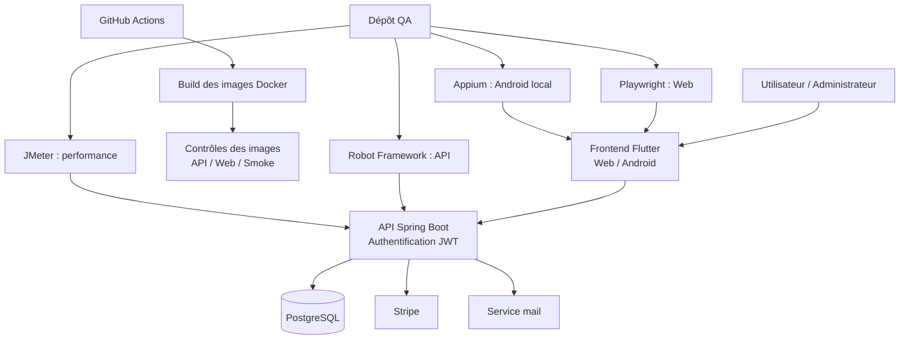

# 🚌 eBus — Plateforme de transport et automatisation QA

**eBus** est une application de gestion du transport composée d’un frontend **Flutter**, d’un backend **Java / Spring Boot** et d’une base de données **PostgreSQL**.

Le projet comprend également une infrastructure Docker et des suites de tests automatisés couvrant les API, les parcours Web, Android et la performance.

## Technologies

### Application


### Infrastructure


### Qualité et automatisation


## Sommaire

- [Présentation](#présentation)
- [Dépôts et déploiements](#dépôts-et-déploiements)
- [Fonctionnalités](#fonctionnalités)
- [Architecture](#architecture)
- [Interfaces de l’application](#interfaces-de-lapplication)
- [Backend](#backend)
- [Frontend](#frontend)
- [Docker : construire et lancer](#docker--construire-et-lancer)
- [Automatisation QA](#automatisation-qa)
- [CI et construction des images](#ci-et-construction-des-images)
- [Rapports et résultats](#rapports-et-résultats)
- [Configuration et sécurité](#configuration-et-sécurité)
- [Documentation](#documentation)

## Présentation

La plateforme permet aux utilisateurs de consulter les informations de transport, gérer leurs abonnements, déclarer des objets perdus et soumettre des réclamations.

Les administrateurs disposent d’interfaces de gestion adaptées à leurs droits.

Le frontend Flutter fournit l’interface utilisateur. Le backend Spring Boot expose les API métier et gère l’authentification, les autorisations et la persistance.

Le dépôt QA complète l’application avec des scénarios de validation et des rapports d’exécution.

## Dépôts et déploiements

| Composant | Dépôt GitHub | Environnement |
| --- | --- | --- |
| Backend | [eBus_backend](https://github.com/ikraammel/eBus_backend) | [API Render](https://ebus-backend-ao2u.onrender.com) |
| Frontend | [eBus_frontend](https://github.com/ikraammel/eBus_frontend) | [Application Web](https://ebus-frontend-1an4.onrender.com/) |
| QA Automation | [eBus-qa-automation](https://github.com/FATIMA-BOUSMITI/eBus-qa-automation) | Exécutions locales et configuration d’automatisation |

Les environnements déployés et les conteneurs locaux constituent des cibles distinctes. Le frontend doit utiliser l’adresse de l’API correspondant à l’environnement testé.

## Fonctionnalités

### Espace utilisateur

- Connexion et accès authentifié.
- Consultation des informations et des lignes de transport.
- Consultation des offres d’abonnement.
- Accès au parcours de paiement Stripe.
- Déclaration et suivi des objets perdus ou trouvés.
- Création et suivi des réclamations.
- Consultation des informations du compte.

### Espace administrateur

- Accès aux fonctions autorisées au rôle administrateur.
- Gestion des lignes et des offres d’abonnement.
- Consultation et traitement des réclamations.
- Gestion des objets perdus ou trouvés.

### Services backend

- API REST.
- Authentification JWT et contrôle des rôles.
- Persistance PostgreSQL.
- Intégration Stripe.
- Notifications par e-mail.
- Endpoint de santé `/api/health`.

## Architecture



<!--
EMPLACEMENT : diagramme d’architecture détaillé.
Ajouter l’image dans docs/screenshots/architecture.png puis décommenter :


-->

## Interfaces de l’application

Les captures ci-dessous sont à ajouter dans `docs/`. Utiliser des comptes de démonstration et masquer les informations personnelles.

### Accueil et consultation des lignes

> 📷 Capture à ajouter : `docs/01-accueil-lignes.png`


### Authentification

> 📷 Capture à ajouter : `docs/02-authentification.png`


### Espace utilisateur

> 📷 Capture à ajouter : `docs/03-espace-utilisateur.png`


### Offres et abonnements

> 📷 Capture à ajouter : `docs/04-abonnements.png`


### Objets perdus et trouvés

> 📷 Capture à ajouter : `docs/06-objets-perdus.png`


### Réclamations

> 📷 Capture à ajouter : `docs/07-reclamations.png`


### Espace administrateur

> 📷 Capture à ajouter : `docs/08-administration.png`


## Backend

### Stack technique

- Java 17.
- Spring Boot 3.2.6.
- PostgreSQL.
- Authentification JWT.
- Intégration Stripe et SMTP.
- Maven pour la compilation et les tests.

### Structure principale

```text
eBus_backend/
├── src/
│   ├── main/
│   │   ├── java/com/gestion/gestion_bus/
│   │   └── resources/application.yaml
│   └── test/java/com/gestion/gestion_bus/
├── ci/
├── docs/
├── .github/workflows/
├── Dockerfile
├── compose.remote.yaml
└── pom.xml
```

### Démarrage natif

Depuis le dépôt backend, après configuration des variables d’environnement :

```powershell
mvn.cmd -DskipTests package
java -jar target/gestion-bus-0.0.1-SNAPSHOT.jar
```

L’API utilise le port `8080` par défaut. La variable `PORT` permet de le modifier.

Vérifier sa disponibilité :

```powershell
Invoke-RestMethod http://localhost:8080/api/health
```

### Tests unitaires

```powershell
mvn.cmd -B "-Dtest=AbonnementServiceImpTest,ObjetPerduServiceImpTest" test
```

### Régressions du catalogue d’abonnements

```powershell
mvn.cmd -B "-Dtest=TypeAbonnementServiceImpTest" test
```

### Tests complets

```powershell
mvn.cmd -B verify
```

Les tests de contexte et d’intégration nécessitent la base dédiée configurée dans `AbstractDatabaseTest`.

Rapports disponibles :

```text
target/surefire-reports/
target/site/jacoco/index.html
```

## Frontend

Le frontend est développé avec Flutter et Dart pour les interfaces Web et Android.

### Démarrage Web local

Depuis le dossier contenant `pubspec.yaml`, avec Flutter installé :

```powershell
flutter pub get
flutter run -d chrome --dart-define=API_BASE_URL=http://localhost:8080
```

Cette configuration suppose une version du frontend utilisant `API_BASE_URL` via `String.fromEnvironment`, comme celle attendue par le workflow Docker.

Pour cibler le backend Docker présenté ci-dessous, utiliser :

```powershell
flutter run -d chrome --dart-define=API_BASE_URL=http://localhost:18081
```

### Compilation Web

```powershell
flutter build web --release --dart-define=API_BASE_URL=http://localhost:18081
```

### Android

L’URL API doit être accessible depuis l’appareil ou l’émulateur. Sur un téléphone, `localhost` désigne le téléphone et non le PC hébergeant le backend.

## Docker : construire et lancer

### Prérequis

- Docker Desktop démarré.
- Les versions des dépôts contenant leurs fichiers Docker.
- Une base PostgreSQL accessible.
- Les variables d’environnement du backend.
- Des ports locaux disponibles.

### Organisation conseillée des clones

```text
workspace/
├── eBus_backend/
├── eBus_frontend/
└── eBus-qa-automation/
```

### 1. Construire l’image backend

Depuis `eBus_backend/` :

```powershell
docker build -t ebus-backend:local .
```

La construction compile l’application sans exécuter les tests et sans contacter la base distante.

### 2. Configurer le backend

Depuis `eBus_backend/` :

```powershell
Copy-Item .env.remote.example .env.remote
```

Renseigner le fichier `.env.remote` avec les paramètres de l’environnement.

```text
DB_URL
DB_USERNAME
DB_PASSWORD
JWT_SECRET
MAIL_USERNAME
MAIL_PASSWORD
STRIPE_SECRET_KEY
STRIPE_WEBHOOK_SECRET
```

`DB_URL` doit être une URL JDBC PostgreSQL externe accessible depuis le poste, par exemple :

```text
jdbc:postgresql://HOTE:5432/BASE?sslmode=require
```

### 3. Démarrer le backend

```powershell
docker compose -f compose.remote.yaml up -d
docker compose -f compose.remote.yaml ps
```

Vérifier l’API :

```powershell
Invoke-RestMethod http://localhost:18081/api/health
```

Cette configuration démarre le backend local dans Docker avec une base distante ; elle ne démarre pas de PostgreSQL local.

### 4. Construire l’image frontend

Depuis la racine du dépôt frontend contenant son `Dockerfile` :

```powershell
docker build --build-arg API_BASE_URL=http://localhost:18081 -t ebus-frontend:local .
```

L’adresse de l’API est intégrée lors de la compilation Flutter Web. Pour changer cette cible, reconstruire l’image.

### 5. Démarrer le frontend

```powershell
docker run -d --name ebus-frontend-local -p 18082:80 ebus-frontend:local
```

Ouvrir :

```text
http://localhost:18082
```

Le navigateur contacte l’API sur `http://localhost:18081`. Le backend doit autoriser l’origine du frontend dans sa configuration CORS.

### 6. Diagnostic

```powershell
docker ps
docker compose -f compose.remote.yaml logs --tail=100
docker logs --tail=100 ebus-frontend-local
```

### 7. Arrêt

Depuis le dépôt backend :

```powershell
docker compose -f compose.remote.yaml stop
docker stop ebus-frontend-local
```

### Environnement obtenu

| Composant | Exécution | Adresse locale |
| --- | --- | --- |
| Backend | Docker | `http://localhost:18081` |
| Frontend Web | Docker | `http://localhost:18082` |
| PostgreSQL | Serveur distant configuré | URL JDBC privée |
| Outils QA | Exécution native selon la suite | Cibles configurables |

Les scénarios métier peuvent modifier les données de leur environnement cible. Utiliser une base dédiée pour les tests nécessitant des créations, modifications ou suppressions.

<!--
EMPLACEMENT : Docker Desktop montrant les conteneurs frontend/backend.

-->

## Automatisation QA

Dépôt dédié : **[eBus-qa-automation](https://github.com/FATIMA-BOUSMITI/eBus-qa-automation)**.

### Pourquoi des tests dans le backend et dans un dépôt QA ?

Les tests du backend vérifient les composants Java et leur intégration avec Spring.

Le dépôt QA valide le comportement de l’application à travers ses interfaces : API, navigateur et Android. Il contient également les scénarios de performance et leur documentation.

La CI désigne le mécanisme d’exécution automatique. Elle peut lancer des tests conservés dans le dépôt applicatif ou dans des suites QA.

| Niveau | Emplacement | Outils | Objectif |
| --- | --- | --- | --- |
| Unitaire | Backend : `src/test/` | JUnit, Mockito | Vérifier les règles métier isolées |
| Contrôleur / intégration | Backend : `src/test/` | Spring Test, MockMvc | Vérifier le contexte et les réponses HTTP |
| Validation des images | Backend : `ci/` et workflow | Robot, Playwright, JMeter | Contrôler les images construites et les parcours ciblés |
| Web et API métier | Dépôt QA | Playwright, Robot Framework | Vérifier les parcours transversaux |
| Android | Dépôt QA | Appium, Robot Framework | Vérifier l’application sur appareil ou émulateur |
| Performance | Dépôt QA | JMeter | Smoke, charge progressive et endurance |

### Structure QA

```text
eBus-qa-automation/
├── playwright/
├── robot-framework/
├── jmeter/
├── appium/
├── docs/
└── README.md
```

### Installation des dépendances Web/API

Depuis le dépôt QA :

```powershell
py -3 -m venv .venv
.\.venv\Scripts\Activate.ps1

python -m pip install -r playwright\requirements.txt
python -m pip install -r robot-framework\requirements.txt
python -m playwright install chromium
```

Configurer les variables requises par les suites :

```text
EBUS_USER_EMAIL
EBUS_USER_PASSWORD
EBUS_ADMIN_EMAIL
EBUS_ADMIN_PASSWORD
EBUS_DEPLOYED_FRONTEND_URL
EBUS_DEPLOYED_BACKEND_URL
```

Les scripts peuvent utiliser des noms de variables supplémentaires : consulter le README de chaque suite avant exécution.

### Tests API — Robot Framework

```powershell
robot --outputdir reports\robot robot-framework\tests
```

### Tests Web — Playwright

```powershell
python playwright\business_e2e.py --case all --headless
```

### Performance — JMeter

```powershell
.\jmeter\run-smoke.ps1
```

Les plans de charge progressive et d’endurance sont réservés à un environnement contrôlé. Le smoke de sept requêtes ne mesure pas la capacité maximale.

### Android — Appium

Après configuration d’ADB, d’Appium et de l’appareil :

```powershell
.\appium\run.ps1 -RemoteInstalled -Authenticated -Serial '<ADB_SERIAL>'
```

Les tests Android restent locaux dans l’organisation actuelle du projet.

<!--
EMPLACEMENT : rapport Robot Framework.

-->

<!--
EMPLACEMENT : résultat Playwright.

-->

<!--
EMPLACEMENT : synthèse JMeter.

-->

<!--
EMPLACEMENT : exécution Appium sur Android.

-->

## CI et construction des images

Le workflow backend `build-images.yml` est configuré pour :

- les push sur la branche `ci/docker-images` ;
- un déclenchement manuel avec `workflow_dispatch`.

### Étapes principales

```text
Déclenchement GitHub Actions
          │
          ├── Construction de l’image backend
          ├── Construction de l’image frontend
          │
          └── Validation des images produites
                   ├── Vérification des paramètres requis
                   ├── Chargement des images Docker
                   ├── Démarrage des applications
                   ├── Contrôle de disponibilité
                   ├── Robot Framework
                   ├── Playwright
                   ├── JMeter smoke
                   └── Publication des rapports
```

Les images sont transmises entre les jobs sous forme d’artefacts. Le workflow consulté ne les publie pas dans un registre Docker.

La base utilisée par le job est une PostgreSQL distante configurée avec GitHub Secrets.

### Lecture des résultats

Les résultats du build, du démarrage et des suites doivent être examinés séparément.

L’étape des scénarios métier Playwright peut convertir certains échecs en avertissements. Un workflow vert ne garantit donc pas que tous les scénarios métier ont réussi.

La configuration QA décrit également une organisation cible après déploiement. Son fonctionnement effectif doit être confirmé par les workflows et rapports du dépôt concerné.

<!--
EMPLACEMENT : vue des jobs GitHub Actions.

-->

## Rapports et résultats

| Rapport | Emplacement |
| --- | --- |
| Tests Java | `target/surefire-reports/` |
| Couverture Java | `target/site/jacoco/index.html` |
| Tests des images en CI | Artefacts GitHub Actions |
| Robot Framework | Dossier de sortie de la commande Robot |
| Playwright, JMeter et Appium | Dossiers indiqués dans les README des suites |
| Synthèses et anomalies QA | `docs/` du dépôt QA |

Chaque résultat doit préciser :

- la date et le commit testés ;
- l’environnement cible ;
- la suite et le nombre de cas exécutés ;
- les succès, échecs et éventuels cas ignorés ;
- les limites et anomalies observées.

Les résultats historiques ne garantissent pas l’état courant du déploiement.

<!--
EMPLACEMENT : couverture JaCoCo avec périmètre et date visibles.

-->

## Configuration et sécurité

- Conserver les secrets dans les variables d’environnement ou GitHub Secrets.
- Ne pas versionner les fichiers `.env` réels.
- Utiliser des comptes et une base dédiés lorsque les scénarios écrivent des données.
- Masquer les données personnelles dans les captures et rapports.
- Distinguer les environnements local, CI, test et déployé.
- Utiliser Stripe en mode test pour les démonstrations de paiement.

Les contrôles CI utilisant des paramètres Stripe et mail factices ne valident pas les paiements réels ni les envois d’e-mails.

La configuration de schéma `ddl-auto=validate` vérifie la compatibilité de la base ; elle ne rend pas les actions métier de l’application automatiquement non modificatrices.

## Documentation

### Application

- [Backend et documentation technique](https://github.com/ikraammel/eBus_backend)
- [Frontend Flutter](https://github.com/ikraammel/eBus_frontend)
- [Construction des images](https://github.com/ikraammel/eBus_backend/blob/ci/docker-images/docs/build-images.md)
- [Tests CI et configuration](https://github.com/ikraammel/eBus_backend/blob/ci/docker-images/ci/README.md)

### Qualité

- [Dépôt QA](https://github.com/FATIMA-BOUSMITI/eBus-qa-automation)
- [Plan de test](https://github.com/FATIMA-BOUSMITI/eBus-qa-automation/blob/main/docs/test-plan.md)
- [Stratégie de test](https://github.com/FATIMA-BOUSMITI/eBus-qa-automation/blob/main/docs/test-strategy.md)
- [Cas de test API](https://github.com/FATIMA-BOUSMITI/eBus-qa-automation/blob/main/docs/test-cases-api.md)
- [Documentation CI/CD QA](https://github.com/FATIMA-BOUSMITI/eBus-qa-automation/blob/main/docs/ci-cd.md)

## Contributions

Les contributions applicatives sont consultables dans l’historique des dépôts backend et frontend.


Conception et maintenance des scénarios Web, API et Android, contrôles de performance, analyse des résultats et documentation QA.
