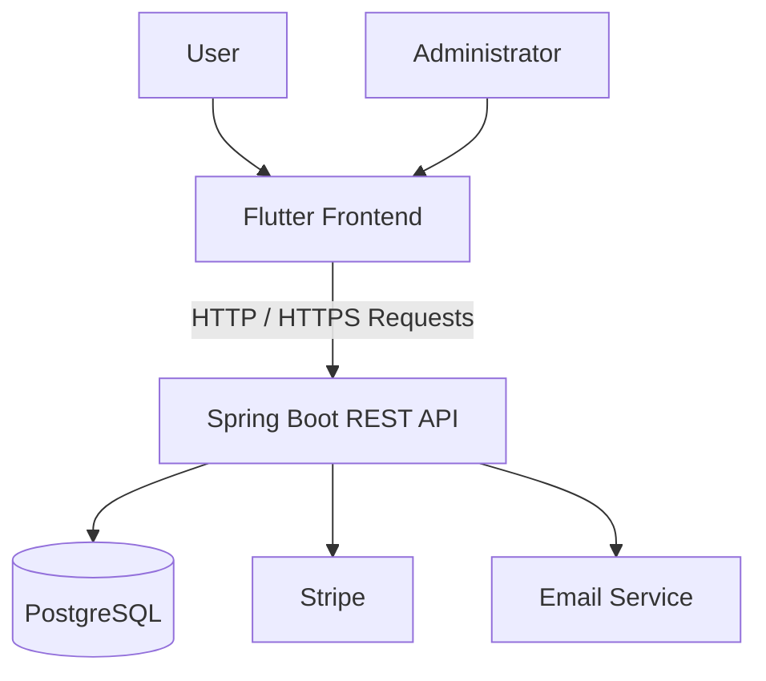

# 🚌 eBus Frontend — Flutter Transportation Application

**eBus Frontend** is the user interface of the eBus transportation management platform, developed using **Flutter and Dart**. It allows users to browse transportation information, manage subscriptions, report lost and found items, and submit complaints.

The application communicates with a **Java / Spring Boot** backend that exposes REST APIs and uses PostgreSQL for data persistence.

## Technologies Used

### Frontend Application


### Backend and Integrated Services


### Infrastructure


## Table of Contents

- [Overview](#-overview)
- [Features](#-features)
- [Application Screenshots](#-application-screenshots)
- [Architecture](#-architecture)
- [Prerequisites](#-prerequisites)
- [Installation and Local Setup](#-installation-and-local-setup)
- [API Configuration](#-api-configuration)
- [Web Build](#-web-build)
- [Android Execution](#-android-execution)
- [Docker](#-docker)
- [Testing and Software Quality](#-testing-and-software-quality)
- [Deployment](#-deployment)
- [Related Repositories](#-related-repositories)

## 📌 Overview

The eBus frontend provides an interface through which users and administrators can access the platform's features according to their permissions.

Developed with Flutter, the application aims to provide a consistent user experience across Web and Android platforms.

The frontend consumes REST APIs exposed by the Spring Boot backend to retrieve data, submit user actions, and display responses from business services.

## 🚀 Features

### 👤 User Area

- User login and access to authenticated features.
- Browse transportation information and routes.
- View subscription plans.
- Access the Stripe payment process.
- Report and track lost or found items.
- Submit and track complaints.
- View account information.

### 🛠️ Administrator Area

- Access features authorized for the administrator role.
- Manage transportation routes and subscription plans.
- View and process complaints.
- Manage lost and found items.

The features actually available depend on the frontend version and the APIs exposed by the backend.


## 🏗️ Architecture



### Frontend Responsibilities

The frontend is responsible for:

- Rendering application interfaces.
- Navigating between screens.
- Collecting and validating user input on the client side.
- Sending requests to REST APIs.
- Displaying responses and errors.
- Providing a user experience across Web and Android.

Authentication, business-level authorization, and data persistence must be enforced and verified on the backend.

## 📋 Prerequisites

Before starting the project, install:

- [Flutter SDK](https://docs.flutter.dev/get-started/install)
- [Dart SDK](https://dart.dev/get-dart) — generally included with Flutter.
- Git.
- Google Chrome for Web execution.
- Android Studio and an emulator, or an Android device, for mobile testing.

Verify your installation:

```powershell
flutter --version
dart --version
flutter doctor
```

## ⚙️ Installation and Local Setup

### 1. Clone the Repository

```powershell
git clone https://github.com/ikraammel/eBus_frontend.git
cd eBus_frontend
```

### 2. Install Dependencies

```powershell
flutter pub get
```

### 3. Analyze the Project

```powershell
flutter analyze
```

### 4. Run the Web Application

If the backend runs on port `8080` and the frontend uses the `API_BASE_URL` variable:

```powershell
flutter run -d chrome --dart-define=API_BASE_URL=http://localhost:8080
```

This command assumes the code reads the variable using `String.fromEnvironment('API_BASE_URL')`. If the project uses a different variable or configuration mechanism, adjust the command accordingly.

## 🔌 API Configuration

The frontend must target the backend URL corresponding to the environment being tested.

| Environment | Example URL |
|---|---|
| Locally running backend | `http://localhost:8080` |
| Local Docker backend | `http://localhost:18081` |
| Deployed backend | `https://ebus-backend-ao2u.onrender.com` |

To run the frontend against the local Docker backend:

```powershell
flutter run -d chrome --dart-define=API_BASE_URL=http://localhost:18081
```

To target the deployed backend:

```powershell
flutter run -d chrome --dart-define=API_BASE_URL=https://ebus-backend-ao2u.onrender.com
```

**Things to verify:**

- The URL matches the intended environment.
- The backend is reachable.
- The CORS configuration allows the Web frontend's origin.
- The required APIs and authentication mechanisms are available.
- Secret keys are not embedded in the frontend code.

In a browser, `localhost` refers to the machine running the browser. On a physical Android device, it refers to the device itself, not the PC hosting the backend.

## 🌐 Web Build

To generate an optimized Web release:

```powershell
flutter build web --release --dart-define=API_BASE_URL=http://localhost:18081
```

The generated files are located in:

```text
build/web/
```

The API URL supplied during compilation must be reachable from the users' browsers. For production, use the appropriate API URL and HTTPS.

## 📱 Android Execution

List available devices:

```powershell
flutter devices
```

Run the application on an Android emulator:

```powershell
flutter run --dart-define=API_BASE_URL=http://10.0.2.2:8080
```

`10.0.2.2` is the special address commonly used by the Android emulator to access the host machine's `localhost`.

For a physical Android device, replace this address with the PC's local network IP address or another URL reachable from the device. The backend must be configured to accept the corresponding connections.

## 🐳 Docker

The Flutter Web frontend can be compiled and served in a Docker container if the repository contains a compatible `Dockerfile`.

From the repository root:

```powershell
docker build --build-arg API_BASE_URL=http://localhost:18081 -t ebus-frontend:local .
```

Start the container:

```powershell
docker run -d --name ebus-frontend-local -p 18082:80 ebus-frontend:local
```

Open the application:

```text
http://localhost:18082
```

Check the container logs:

```powershell
docker logs --tail=100 ebus-frontend-local
```

Stop the container:

```powershell
docker stop ebus-frontend-local
```

This setup assumes that the frontend's `Dockerfile` uses the `API_BASE_URL` build argument when compiling Flutter Web and that a Web server, such as Nginx, serves the generated files.

**Important:** If the browser accesses the frontend at `http://localhost:18082`, an API configured as `http://localhost:18081` is reachable only when the browser runs on the same machine as the backend. This configuration is suitable for a local demonstration environment, not for a public URL.

## 🧪 Testing and Software Quality

The application's quality can be assessed at several levels.

### Flutter Static Analysis

```powershell
flutter analyze
```

### Flutter Tests

If the repository contains Flutter tests:

```powershell
flutter test
```

### API and Functional Testing

API integration tests, Web tests, Android tests, and performance tests are maintained in the associated QA repository:

- **Robot Framework:** API testing.
- **Playwright:** Web end-to-end testing.
- **Appium:** Android testing.
- **Apache JMeter:** Performance testing.

QA repository: [eBus-qa-automation](https://github.com/FATIMA-BOUSMITI/eBus-qa-automation).


**eBus Project — Flutter Frontend**

A Web and Android interface for a transportation management platform, integrated with Spring Boot REST APIs and supported by a software quality assurance approach.
